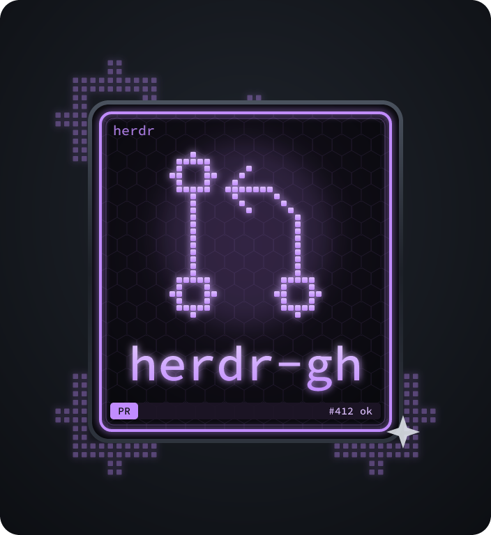

<table>
<tr>
<td width="200" valign="top"></td>
<td valign="top">

# herdr-gh

A [herdr](https://herdr.dev) plugin that puts each workspace's pull request in
the sidebar — number, CI and review in a few characters, next to the branch:

```
◑ api-auth-fix
  fix/auth-expiry #412│×│!
✓ docs-update
  docs/readme #415│√│+
● search
  feat/search d418│•
  old/cleanup #401│↗
```

| part | meaning |
|---|---|
| `#412` / `d412` | PR number (`d` = draft) |
| `√` `×` `•` | CI passed, failed, running |
| `+` `!` | review approved, changes requested (blank while waiting) |
| `↗` | merged — time to remove the worktree |
| `†` | closed without merging |

Workspaces whose branch has no PR show nothing. Symbols are deliberately
plain so most monospace fonts have them; all of them are configurable.

## Requirements

- herdr 0.9.3+
- [`gh`](https://cli.github.com), logged in (`gh auth login`)
- `jq`, `git`, `bash`

## Install

```sh
herdr plugin install jwarykowski/herdr-gh
```

Then add the `$gh` token to the sidebar in herdr's `config.toml` (this is the
default layout plus `$gh`):

```toml
[ui.sidebar.spaces]
rows = [["state_icon", "workspace"], ["branch", "git_status", "$gh"]]
```

The reporter starts with each herdr session, polls every minute, and exits
when herdr stops. Values expire after three missed polls, so nothing stale is
left behind.

## Actions

| action | does |
|---|---|
| `jwarykowski.herdr-gh.refresh` | report now instead of waiting for the next poll |
| `jwarykowski.herdr-gh.restart` | restart the reporter, e.g. after a config change |

Bind one if you like:

```toml
[[keys.command]]
key = "prefix+alt+r"
type = "plugin_action"
command = "jwarykowski.herdr-gh.refresh"
description = "refresh GitHub status"
```

## Hooks

Run your own commands when a PR changes: an executable in
`$(herdr plugin config-dir jwarykowski.herdr-gh)/hooks/` named after the event.

| event | when |
|---|---|
| `pr.merged` / `pr.closed` | the PR was merged / closed without merging |
| `ci.passed` / `ci.failed` | checks finished |
| `review.approved` / `review.changes_requested` | the review decision changed |

Changes are spotted by the poll, so a hook runs up to a minute after the
event. A PR the reporter hasn't seen before is only recorded, so restarts and
branches merged while herdr was closed fire nothing.

Hooks get `HERDR_GH_EVENT`, `_PR` (number), `_URL`, `_REPO` (`owner/name`),
`_TITLE`, `_BRANCH` and `_WORKSPACE_ID`, and log to `hooks.log` in the
plugin's state directory. For example, `hooks/pr.merged`:

```sh
#!/bin/sh
herdr plugin action invoke party --plugin jwarykowski.herdr-zsa-lights
```

## Configuration

Optional. Put overrides in `config.env` inside the plugin config directory
(`herdr plugin config-dir jwarykowski.herdr-gh`), then run the restart action.
See [`config.env.example`](config.env.example) for every setting.

## How it works

For every workspace the reporter takes the first pane's directory, asks
`gh pr view` about the checked-out branch, and reports the result with
`herdr workspace report-metadata` under the source `herdr-gh`. That is about
one GitHub API call per workspace per poll.

## Support

herdr-gh is free and MIT licensed. If it saves you a trip to the browser, you
can [sponsor its development](https://github.com/sponsors/jwarykowski).

## License

</td>
</tr>
</table>

MIT
